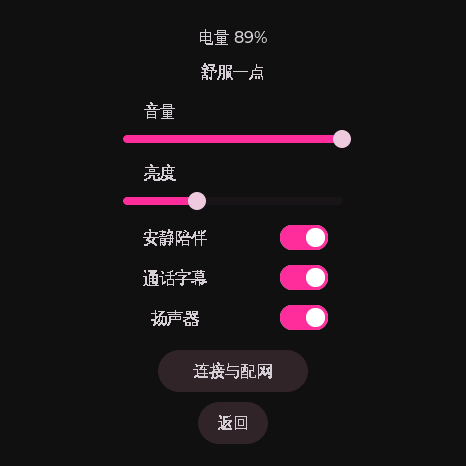
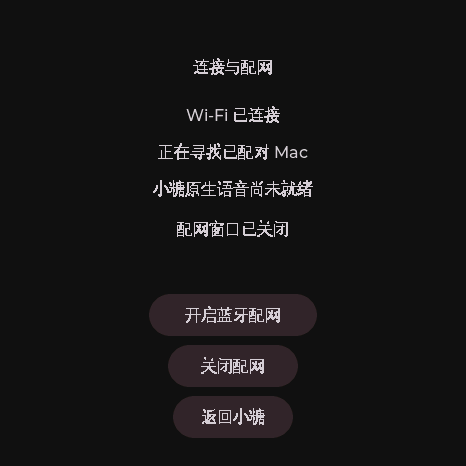
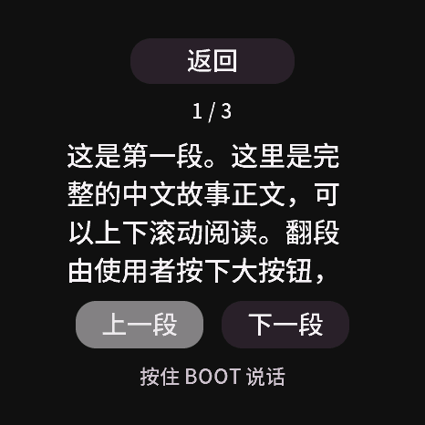
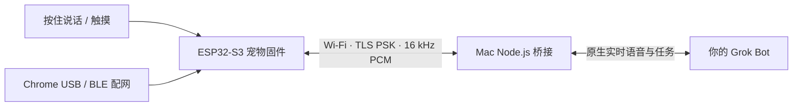

# Grok Bot ESP32 Companion · 小糖 AI 陪伴宠物

[English](README.en.md) · [快速开始](docs/GETTING_STARTED.zh-CN.md) · [实体按键语音入口](docs/VOICE_INPUT.md) · [架构](docs/宠物固件架构.md) · [验收与限制](docs/VALIDATION.md) · [贡献指南](CONTRIBUTING.md)

把 **微雪 ESP32-S3-Touch-AMOLED-1.43C** 变成一个会眨眼、会回应抚摸、可以按住说话的桌面 AI 小宠物。设备运行独立宠物固件，Mac 负责桥接你已有的 Grok Bot；保留 Bot 的原生声音、上下文和任务能力。

这是一项社区实验项目，与 xAI、Grok Bot、Meta、Waveshare 没有隶属或背书关系。当前原生连接使用 Grok Bot 桌面 App 的内部契约，**需要正常登录及相应账户权限，不是公开稳定 API 的兼容承诺**。不包含 App、账号或云服务，不绕过登录和权限。

<p align="center">
  
  
  
</p>

上图为真实设备屏幕导出。界面、中文字形和板型当前针对这一块 466×466 圆屏设计。

开发分支已加入28px大字主屏、30px独立阅读页和三项大设置入口，采用Noto Sans SC灰度字形。参考设备已确认文字、按钮、原生声音、分页阅读、播放打断与连续十轮中文；详细成绩和此前失败见[验收记录](docs/VALIDATION.md)。这些成绩属于各自测试镜像，尚未发布新版本。

最新一轮继续打磨日常体验：连接恢复后明确要求松开再按，避免录到半句；轻点抬眼、抚摸跟随、三连点温和躲闪和唤醒伸展；表情连续过渡，说话动作随真实播放电平收放。语音仍由实体BOOT控制。操作和本轮独立验收见[体验说明](docs/COMPANION_POLISH.md)，未沿用旧镜像的实物成绩。

开发分支还加入长待机恢复：本机复现原生服务约15分钟闲置后主动关线，现于完全空闲时申请新凭证并续接原通话，服务器确认原会话后才恢复说话入口。需要配套新固件的`native_resume`能力；旧固件保留原断线恢复方式。192项本地检查、独立审查、完整备份和应用槽读回已通过，自然闲置及真人首次回答单独记录在[本轮验收](docs/idle-first-use-validation.json)。



上图使用固定公开文字，来自当前固件UI的主机渲染，不是实机照片。

根据随后实物反馈，开发分支继续调整了低档音量刻度、返回／翻段命中区域和右滑返回，升级保留原实际响度。[操作说明与真实UI示例](docs/UI_USABILITY.md)列出新旧刻度关系；本轮实物手感另行验收，不能沿用先前点击成绩。

如需查看本轮开发源码，克隆后切换到 `codex/v0.2.0-roadmap` 分支；运行 `npm run preview` 可查看无声交互预览。设备安装仍须按快速开始完成备份和构建。

## 它能做什么

| 能力 | 当前实现 |
|---|---|
| 陪伴互动 | 本地呼吸、眨眼、抚摸反馈与逐渐消退的情绪余韵；断网时仍能互动和调整设置 |
| 原生对话 | 按住实体 BOOT 录音、松开提交；播放时再次按住清除旧音频并开始新问题；屏幕仅显示操作提示 |
| 界面 | 程序绘制粉色圆脸、听说状态、失败提示、字幕分段阅读、音量／亮度／安静模式与连接页 |
| 联网 | 2.4 GHz Wi-Fi；配对 Mac 的局域网发现与保存地址回退 |
| 配置 | USB 配网；限时、带六位码认证的 BLE 配网，蓝牙不承担日常语音 |
| 任务 | 使用同一 Bot 的任务通道；断线不自动重提任务，结果按同次通话消息 ID 去重 |
| 休息 | USB／电池采用不同闲置策略，熄屏时停止绘图；安静模式默认开启 |
| 可恢复 | 先做完整 8 MiB 校验备份，再仅写应用槽；安装和恢复会核对设备身份、摘要及引导元数据 |

## 系统如何连接



正常对话没有引入 Gemini、额外 STT 或额外 TTS。账户与临时语音凭证只在 Mac 使用；设备只持有随机的局域网配对密钥。可选的声学台架工具会使用系统合成音来模拟测试者，和产品语音路径分开。

## 适用条件

- **已验证硬件**：Waveshare ESP32-S3-Touch-AMOLED-1.43C，466×466，8 MiB flash／PSRAM，原板显示、触摸、麦克风及扬声器。不承诺其他 ESP32-S3 板型直接可刷。
- **Mac 常驻**：macOS、Node.js ≥22.19、Xcode Command Line Tools；Grok Bot App 已正常登录，拥有一个可原生语音通话的 Bot。参考验证 App 版本为 0.71.2／0.72.1；后续版本可能改变契约。
- **局域网**：Mac 和设备在互通的私人局域网，路由器允许设备访问 Mac；无需端口映射。Mac 多个有效网卡时程序会拒绝猜测地址，请见排错指南。
- **固件开发**：Python ≥3.11、ESP-IDF **6.0.1**，其余组件版本由 `dependencies.lock` 固定。

首版是 **源码发布**，没有附带固件 `.bin`。公开版安装工具只支持本文明确的 Muse 兼容分区和已确认的 ota_0 引导状态；它会拒绝其他布局，不负责给任意出厂固件改分区。请先阅读[完整安装与恢复说明](docs/GETTING_STARTED.zh-CN.md)。

## 先验证 Mac 语音

```sh
git clone https://github.com/vliuyt/grok-bot-esp32-bridge.git
cd grok-bot-esp32-bridge
npm test
node src/cli.mjs bots
node src/cli.mjs serve --bot "你的 Bot 名称"
```

打开 <http://127.0.0.1:8788>，点击「连接」，允许麦克风权限，按住按钮说话并松开听回答。首次读取登录时，macOS 可能要求允许访问 **Grok Bot Safe Storage**；程序只读取现有正常登录，不修改 App 登录资料。

Mac 这一步通过后，再依次完成：**安装固件开发环境 → USB 备份 → 构建 → 应用槽安装 → 设备 USB 配网 → 启动设备桥接**。详细命令、分区条件及恢复办法见[快速开始](docs/GETTING_STARTED.zh-CN.md)。

`npm test` 不连接账户、不执行声学测试、不刷机。本开发分支首次未构建固件时，5项需要目标依赖的检查会明确跳过，包括真实LVGL字形与页面检查；完成目标构建后再次测试，应能运行这些检查。本地已运行192项、零跳过。测试包含Swift编译与带内存检查的C主机程序，推荐在Mac上运行。

## 当前验证进展

2026-10-19 的参考设备完成了：十轮中文声学路径、37.1 秒连续回答、Wi-Fi 失败回退、USB 配置、蓝牙服务发现、正常／事件通道故障下的静音任务回流，以及两小时静音稳定性检查。首段原生音频到 Mac 为 737–1097 ms，中位 862.5 ms；这不等同于设备实际出声延迟。

**仍待完成**：完整声学打断／重连、实体触摸手感、BLE 配对码认证写入、电池拔线与白天主动招呼。代码已包含这些路径，但不能把模拟测试或蓝牙广播当作全部实机验收。公开版新增的通用安装和服务打包逻辑做主机验证，尚未用另一台设备安装验证。详细口径见[验收记录](docs/VALIDATION.md)。

## 项目结构

```text
firmware/pet/             独立 ESP-IDF 宠物应用与板级驱动
firmware/tools/           构建、备份、安装和可选台架工具
firmware/tools/vendor/    随包 USB 串口模块（Apache-2.0）
src/                     Mac 原生语音、任务、加密局域网和配网页面
native/                  Swift 麦克风／扬声器辅助程序
scripts/                 可选 macOS 登录服务安装
tests/                  C／Node.js／Python 行为测试
docs/                    从零使用、架构、协议、排错和验收边界
```

`firmware/grok_*` 保留旧线协议的回归夹具；当前独立固件入口是 `firmware/pet/main/pet_app.c`。不需要相邻 Muse SDK 目录，也不需要作者的私人配置。

## 限制与迭代方向

- Mac 必须保持登录、联网、不休眠；暂不支持脱离 Mac 或 Windows／Linux 原生语音桥接。
- 原生接口可能随 App 更新失效；App 音频通话桥接备用路线尚未实现。
- 最多缓存约 180 秒未播放音频，超限会取消并重连，不恢复旧回答。
- 持久化同次通话历史是任务结果来源；仅存在于瞬时 SSE 的特殊通知尚未验证。
- 桥接页面的「挂断」暂停接入，但程序重启后不保留暂停状态；夜间可用停止脚本停用服务。
- 主动行为时钟目前固定上海时区（UTC+8），未提供地区设置。
- 清醒／困倦共用 30 fps 回调，尚无实测电流与续航结论。

后续优先完善实物验收、可重复的预编译发行、配网体验和功耗。计划见 [ROADMAP](docs/ROADMAP.md)，欢迎提交复现步骤或参与开发。

## 开源许可与来源

项目原创代码采用 [Apache-2.0](LICENSE)。复用的 Muse 板级代码、USB 工具保留 Meta 的原版权与 Apache 许可；Noto Sans SC与Unifont字体转换文件单独按 **OFL-1.1** 分发。完整来源、例外和许可文本见 [THIRD_PARTY_NOTICES](THIRD_PARTY_NOTICES.md)。品牌名称及商标不由本项目授权。

不提交账户凭证、局域网配对密钥、Wi-Fi 密码、个人设备备份或录音。提交问题前请按 [SECURITY](SECURITY.md) 清理日志。
