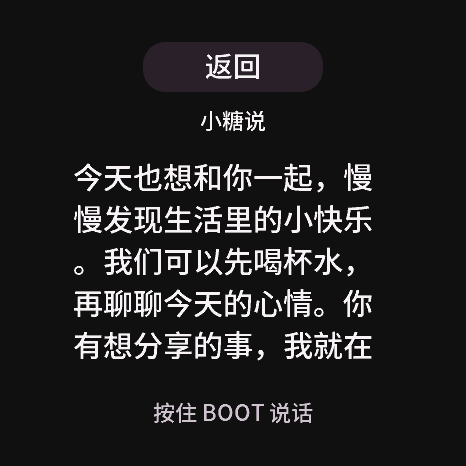
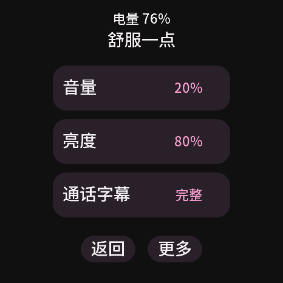
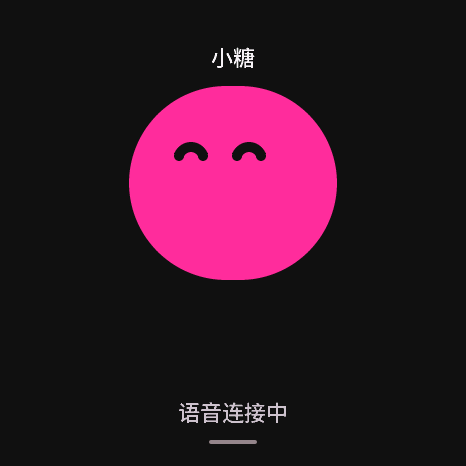
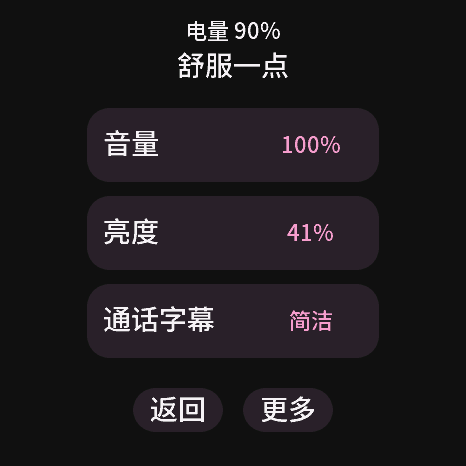

# 小圆屏可读性设计与固件

2026-10-20：使用者认为文字不够清楚，希望参考微软雅黑一类适合屏幕的黑体效果。目标是提高实际阅读和操作体验。本文记录可点击设计稿与随后完成的开发固件实现。2026-10-20为主机验证阶段；2026-10-21已刷入参考设备，当前验收见下文。

运行 `npm run preview`，访问 <http://127.0.0.1:8877/readability.html>。可比较现有网页小字布局和新版清晰布局，并试用陪伴、阅读、设置三类界面及两档字号。固定字幕来自现有C策略导出的示例，不使用私人聊天；设置值只在本页临时演示，不保存到设备。

## 观察与设计

固件中文当前是16px、1bpp Unifont点阵；原网页圆屏缩放又进一步缩小了文字的视觉尺寸。新版同时调整字形、大小、对比度和信息密度。网页的“现有小字”使用当前网页的系统字体和16px逻辑字号，不宣称逐像素模拟设备点阵。

| 项目 | 清晰档，466逻辑像素圆屏 | 大字档 |
|---|---|---|
| 字形 | Noto Sans SC Medium衍生预览子集 | 相同 |
| 主屏正文 | 28px，40px行距，最多两行 | 32px，40px行距 |
| 阅读正文 | 30px，42px行距，五行视窗 | 34px，48px行距，四行视窗 |
| 状态与BOOT提示 | 22px | 22px |
| 设置主文字 | 28px，整行74px高可点 | 相同 |
| 正文颜色 | #f5f3f5，背景#101010 | 相同 |

主屏保留圆脸、两行首句和BOOT提示。点字幕进入独立阅读页；页面只显示当前最多320字节片段，手动滚动，无对话历史承诺。字幕关闭仍保留操作和本地互动提示。完整／简洁模式在此设计稿的主屏都概览首句，阅读页展开当前片段，此交互已用于开发固件。

设置示例每页三项，展示音量、亮度和字幕；连接、配对、安静陪伴及其他现有功能将在固件落地时保留于二级页面，本稿没有移除或改动设备功能。BOOT仍是语音入口，屏幕点击不会采集声音。

## 字体与落地边界

设计稿使用本地64KB WOFF，离线可加载；它仅覆盖固定界面与示例的400个字形。来源、摘要和OFL文本在 [字体目录](../preview/companion/fonts/README.md)。字体选择的标准是字形清晰、笔画适中、开口足够、中文覆盖及适合嵌入式资源预算。

生产固件需要另行选择中文覆盖范围，生成有灰度的LVGL字库，并核对整个应用槽大小、缺字回退、emoji处理、绘制内存和语音期间的刷新性能。不得把此预览子集直接当作通用聊天字库。浏览器矢量字体的抗锯齿和物理屏幕输出不同，网页比例也不等于设备实际大小；最后须在1.43C上以正常观看距离验收；本次固件只包含清晰档，大字档仍是网页比较稿。

本轮已修改固件源码并完成本地构建，没有刷机、修改设备设置或播放声音。

主机测试、独立审查与浏览器检查见[设计稿检查记录](readability-preview-validation.json)。主屏对比、大字阅读和设置画面均使用固定示例。

## 已确认后的固件落地

使用者同意继续。首个固件实现采用当前预览默认的清晰档：主屏28px、阅读30px、提示22px、设置28px；32／34px档继续作为预览对照，不在本次增加设备字号偏好或修改旧配置结构。

28px中文主字库覆盖GB2312的6763个汉字、ASCII及常用标点，以2bpp灰度生成；30px阅读字库覆盖其中一级3755汉字及相同标点，其余3008汉字回退到28px灰度字形。首次全量28／30px构建超出原应用槽99808字节，因此分级回退，不改变分区；原有其他中文、假名和全角字符通过独立回退字库保留。回退字体只保留主字库未覆盖部分，防止重复存储。所有新字体沿用现有应用槽和源码绑定校验，不更改分区。生成必须核验上游摘要、字形覆盖、字体位图索引上限及应用槽容量；超限时停止构建，不能静默删字。

主屏和阅读页分别显示首句概览和当前完整片段；字幕关闭、新一轮、断线时不能遗留正文。普通脱敏导出同时隐藏两个文字区域与配对码。BOOT开始录音时立即回主屏，关闭所有设置子页。常用设置仍为音量、亮度、字幕三项；安静陪伴、扬声器、网络状态和蓝牙配网放在“更多”与连接子页，保留原动作和存储接口。

先完成主机真实LVGL的字形／页面／脱敏像素测试、ESP-IDF构建和独立审查。设备刷写、实屏观看、触摸手感及语音性能仍是后续人工验收，不把静音主机结果标成实机通过。

## 固件页面与检查结果（2026-10-20）

- 主屏：200px经典圆脸、28px首句摘要，最多两行，过长以省略号提示；22px BOOT提示独立保留。点击真实正文进入阅读；互动提示不可点开。
- 阅读：30px主字体，320px宽、205px高的五行视窗，手动滚动当前片段。按住BOOT开始新一轮时回主屏；字幕关闭、清空或语音断线也退出阅读并清正文。
- 设置：音量、亮度、通话字幕各占一行74px高；音量／亮度进入独立滑杆页。更多中保留安静陪伴、扬声器、连接状态，连接页保留蓝牙配网开启／关闭和六位码。电量在设置子页显示。
- 字体：22px受控文案、28px主体、30px阅读均为灰度；非常用汉字继续使用原16px像素回退。旧字符覆盖已通过逐字检查；这不代表所有Unicode或emoji均可显示。

以下是**真实生产UI代码由LVGL在主机渲染的固定示例**，没有录制设备屏幕或使用私人对话：

| 主屏 | 阅读 | 设置 |
|---|---|---|
|  |  |  |

[本轮检查记录](firmware-readability-validation.json)记录构建大小、目标配置和主机交互／隐私检查。设备上的正常距离可读性、触摸手感、重启保留、语音期间的绘制性能仍待验收。当前开发代码未发布新版本。

独立审查后的修复：阅读入口和真实触摸／滚动会刷新唤醒计时，连续动作按一秒节流；使用当前LVGL的串行绘制配置，并以编译期门禁拒绝不安全的双绘制配置。主机测试覆盖115秒闲置后的阅读、滚动后跨越旧休眠边界、节流及不安全配置拒绝；流畅度与语音期间表现仍需实屏测量。

## 参考设备验收（2026-10-21）

新版应用已通过保护安装器刷入参考1.43C，升级前保存并回读验证完整8MiB私人备份，升级只写原应用槽并回读校验。原有网络、配对和设置保留；恢复继续使用快速开始中的应用槽恢复流程，备份文件不进入仓库。

使用者已确认「文字清楚，点击也更容易」。以下是设备自身导出的脱敏画面，和前面的主机渲染图分开记录：

| 设备主屏 | 设备设置 |
|---|---|
|  |  |

三分钟只读观察无复位、音频故障或新事件丢失；这不是长时间稳定性或语音通过证明。第一轮真人BOOT试说有上行音频，但没有识别结果和声音回复；相同原生Bot会话的固定中文音频对照有识别和音频返回（仅计数，不播放），正在复测设备路径。因此目前只确认字形与设置触摸改善，语音回复、真实字幕阅读滚动和相关回归尚未通过，未发布新版本。详情见[设备验收记录](readability-device-validation.json)。
