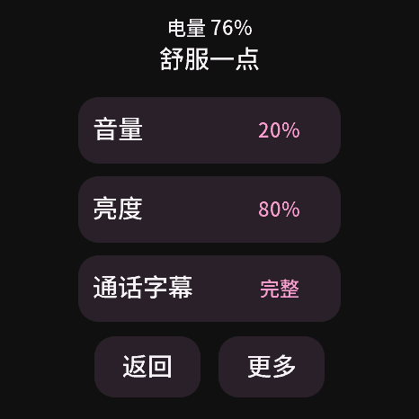
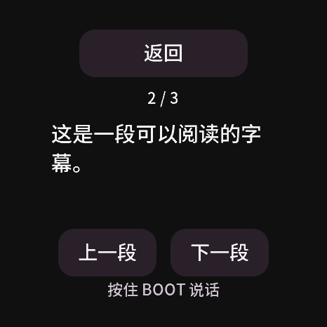

# 音量刻度与更容易操作的圆屏

开发分支改进；2026-10-21。起因是参考设备反馈：旧刻度10%～20%几乎听不见，返回常要点击5～10次。

## 音量

原驱动的0～100对应约-50～0 dB，0单独静音；旧20对应-40 dB。新版屏幕百分比改为近似信号幅度，减少低档的大段难以听清范围。例如新版10%发出原驱动60，新版20%发出72，新版50%发出88。

- 0仍静音，100仍为原来的最大输出，没有增加功放增益。
- 原音量存储格式与音频驱动不变。只打开页面、升级或重启不会把显示值写回，保持原实际输出。例如旧65显示约13%，但声音没有自行改变。
- 只有使用者拖动滑条时，界面百分比才换算成驱动值保存。最小非零存量值显示1%；整数刻度有量化误差。
- 百分比不是声压计读数，也不等于主观响度。实际以听得清、舒适为准，不统一要求调到10%～20%。

USB状态中的`device.volume`仍是原驱动值，保持已有工具兼容；不要将它直接与屏幕百分比比较。

## 返回与触摸

- 单独返回键改成240×68 px；双列底栏改为118×68 px；阅读翻段键加高到68 px。按钮额外扩展8 px命中范围，可见按钮主体互不重叠。审查记录了一项暂缓小项：相邻设置行的透明扩展边缘有2 px重叠，边缘触点会归属后一行。
- 设置入口底部短横的透明可点宽度扩大到200 px。按钮按下立即变色，不等待主题过渡动画；不可用的翻段键变淡。
- 设置和阅读页面右滑返回上一层。在空白处或普通控件上向右滑约48 px（参考屏幕约4毫米），允许轻微斜度，明确右滑在移动中即返回；主屏横向动作仍是抚摸。
- 从音量／亮度滑条开始的拖动不触发返回；已经开始的纵向正文滚动也不触发返回。短距离抖动和左滑不作返回。
- BOOT、页面自动关闭或右滑切页后，旧控件的按压状态失效，松手不会再次点击原页面。
- 一次手指落下最多返回一层；先出现明显纵向移动的动作保持为滚动，不会随后转成返回。

较大的阅读导航占用部分正文空间；正文保持30 px，段内仍可上下滚动。以下来自真实固件UI的主机渲染，使用固定公开文字，不能代替实物手指验收。

## 验证边界

真实LVGL指针测试覆盖各子页面返回键的周边落点和轻微移动、即时高亮、全部层级右滑、滑条排除、纵向滚动、页面切换取消旧按压、翻段和重试文字完整显示。音量测试覆盖静音、低档、最大值及打开页面不产生设置写入。

2026-10-22使用者确认返回键基本一次命中、低档声音改善，同时报告右滑成功率较低。随后主机真实UI复现了较短、斜向及移动中尚未返回的场景：旧实现只在松手判断，要求至少80 px且横向距离至少为纵向的两倍；板端松手读取还可能沿用上一采样点。后续修复从实际收到`PRESSING`的控件采样移动，放宽到48 px与3:2方向比，保留滑条排除及纵向方向锁；不等待新的松手坐标。

新回归覆盖所有子页面较短／斜向右滑、稀疏移动采样、松手坐标重复、一次手势仅退一层、先纵向后横向不返回。坐标校准未作推测性修改。随后使用者按3～5次来回尝试的提示复测设置页，确认“基本每次都能返回”。这是参考设备上的定性确认，未报告精确次数或测量成功率；阅读页手势、滑条排除仍只有主机用例，不能扩大为全部实物交互验收。当前记录见[本轮验收](companion-evolution-validation.json)。无声网页设计稿不完整复现本页的新布局，以上真实UI渲染用于检查这一版。
