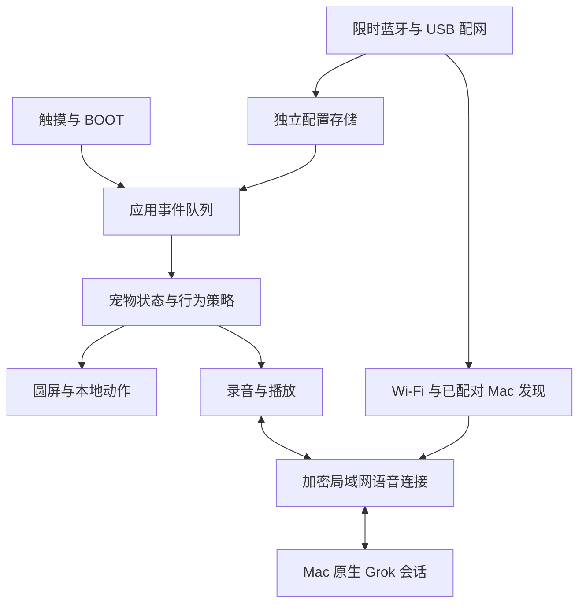

# 宠物固件架构

固件位于 `firmware/pet/`，独立构建和运行。原 Muse 工程不参与应用启动；本版只复用并记录出处的微雪低层驱动和字体。

## 职责和边界

| 模块 | 职责 |
|---|---|
| `pet_core` | 可在主机测试的状态转换、表情参数、手势和休眠规则；不直接访问网络或硬件 |
| `pet_ui` | LVGL 圆屏、设置、连接页和脱敏截图；UI 回调只投递事件 |
| `pet_audio` | 单一音频任务管理 16 kHz PCM、队列、实际写入能量、录音收尾、播放排空及失效标记 |
| `pet_link` | 单一连接任务拥有 TLS；连接代数和轮次隔离旧数据，断线不重放录音或任务 |
| `pet_network` | 使用 RAM 模式管理 Wi-Fi；保存网络选择、候选连接验证与回退、配对身份过滤的 mDNS 发现 |
| `pet_provision` | 五分钟配置窗口、临时 BLE 配对、加密及 MITM 验证、分块限制、超时与重复请求保护 |
| `pet_store` | 严格配置校验、独立 NVS 保存及对旧命名空间的只读迁移 |
| `board_port` | 原板的显示、触摸、I2S 音频、按键和电池接口 |
| `main` | 串行处理行为与设置变更，协调网络、音频、显示和电源 |

Mac 的账户和临时语音凭证不离开 Mac。设备只保存随机的局域网配对密钥。局域网服务元数据只发布版本和公开桥接标识；标识由已有随机密钥派生，不公开密钥本身。

## 语音时序

1. BOOT 按下立即清除本地旧播放，创建新轮次并通知 Mac 开始录音。
2. 设备只在本轮录音期间上传 PCM；松开后音频任务确认最后一块已送出，再发送结束指令。
3. 回答音频按序进入固定播放队列，界面根据实际音频写入更新说话动作。
4. 收到云端“完成”不立刻回到待机；队列耗尽并给 I2S 留出排空时间后才结束播放状态。
5. 新问题会使旧代数／旧轮次和已出队的旧播放块失效；更大轮次可取消尚未提交的旧录音，不会暗中提交它。

发送与接收队列固定容量，超限采用取消／重连处理。正常播放期间不会重复拿音频电源锁；短等待向上取整到至少一个系统时钟单位。目标板使用 1000 Hz FreeRTOS 时钟，TLS 和大幅绘图分配到板载 PSRAM。

## 故障和恢复

| 状态 | 行为 |
|---|---|
| Wi-Fi 离线 | 本地宠物和设置继续工作，停止上传 |
| Mac 不可达 | 指数退避寻找已配对 Mac，最长约 30 秒，不补发旧录音 |
| 原生语音未就绪 | 连接页明确区分于 Wi-Fi 和 Mac 状态 |
| 任务通道异常 | 保留普通语音；SSE 仅触发按当前通话补读持久化结果，用真实消息 ID 去重。读取单飞、失败冷却，挂断会取消；不重提任务 |
| 新 Wi-Fi 验证或写入失败 | 保留旧配置并恢复旧网络 |
| 备份提交中断 | 校验已有候选文件与耐久日志后恢复提交，不覆盖原备份 |
| 应用损坏 | 同一设备身份和完整备份校验后，仅恢复应用槽位 |

生产不会保存录音或桥接端聊天日志；本地语音历史只按 Grok Bot 原生通话流程保存到小糖。台架测试只持久化时延、计数、布尔检查和经过脱敏的屏幕图像。

## 来源

复用板级驱动的原始路径和摘要见 `firmware/pet/components/board_port/vendor/provenance.json`，Apache 2.0 许可全文保存在 `docs/third-party/Muse-Apache-2.0.txt`。中文字形为未修改的 GNU Unifont 16.0.04 子集，作者、双许可及上游来源见字体目录 README。ESP-IDF、LVGL、NimBLE 和管理组件各自的许可随固定依赖保留。
